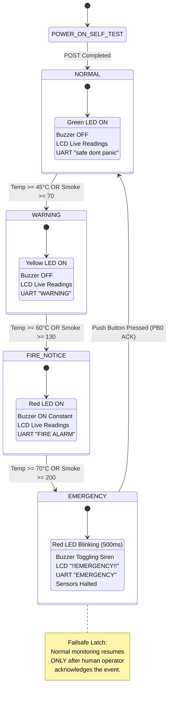

# 🔥 Autonomous Fire & Smoke Detection and Safety Management System

<div align="center">

[](https://www.microchip.com/en-us/product/ATmega32)
[-00599C?style=for-the-badge&logo=c&logoColor=white)]()
[-2E7D32?style=for-the-badge)]()
[-673AB7?style=for-the-badge)]()
[-00838F?style=for-the-badge)]()
[]()
[](LICENSE)

*A robust, layered-architecture embedded safety system built on the Microchip/Atmel ATmega32 AVR microcontroller. It continuously monitors ambient temperature and combustible smoke/gas levels, classifies environmental hazards through a 4-tier finite state machine (FSM), executes automated audiovisual alarms, and enforces a fail-safe emergency latch with manual user acknowledgment.*

---

### 👥 Developed by Team 7 — *Resistors on Fire*
**National Telecommunication Institute (NTI) — Embedded Systems Training Program**  
**Project Partner / Organization:** Gestell Company

</div>

---

## 📑 Table of Contents

1. [System Overview & Motivation](#-system-overview--motivation)
2. [Key Engineering Features](#-key-engineering-features)
3. [Software Layered Architecture](#-software-layered-architecture)
4. [Hardware Bill of Materials & Pin Mapping Matrix](#-hardware-bill-of-materials--pin-mapping-matrix)
5. [State Machine & Threat Classification Logic](#-state-machine--threat-classification-logic)
6. [Cooperative Non-Blocking Scheduler & Timing](#-cooperative-non-blocking-scheduler--timing)
7. [Power-On Self-Test (POST) Diagnostic Routine](#-power-on-self-test-post-diagnostic-routine)
8. [Sensor Signal Processing & Conversion Math](#-sensor-signal-processing--conversion-math)
9. [UART Telemetry & Diagnostic Interface](#-uart-telemetry--diagnostic-interface)
10. [Memory Footprint & Resource Utilization](#-memory-footprint--resource-utilization)
11. [Repository & Codebase Structure](#-repository--codebase-structure)
12. [Build, Simulation & Flashing Guide](#-build-simulation--flashing-guide)
13. [Configuration & Calibration Guide](#-configuration--calibration-guide)
14. [Team Roster & Contribution Matrix](#-team-roster--contribution-matrix)
15. [License & Acknowledgments](#-license--acknowledgments)

---

## 📖 System Overview & Motivation

In commercial, industrial, and smart-building facilities, timely warning and automated emergency escalation are critical to life safety and asset protection. Delayed alerts or false alarms can cause catastrophic damage or complacency.

The **Autonomous Fire & Smoke Detection System** is an embedded real-time safety controller developed in Embedded C for the 8-bit **Microchip ATmega32** MCU running at **8.0 MHz**. The system acquires environmental signals from two analog sensors:
1. **LM35 Precision Centigrade Temperature Sensor** ($10\,\text{mV}/^\circ\text{C}$).
2. **MQ2 Combustible Gas & Smoke Sensor** (0–5000 mV analog output).

By continuously processing these signals via an on-chip 10-bit Successive Approximation ADC, the firmware evaluates safety margins against calibrated thresholds across four operational hazard tiers:
- **Level 0 (Normal):** Environment safe, system continuously sampling.
- **Level 1 (Warning):** Thermal or smoke anomaly detected, visual alert asserted.
- **Level 2 (Fire Notice):** Definite fire condition detected, audible siren and visual warning active.
- **Level 3 (Emergency):** Extreme danger threshold breached; system enters a **fail-safe hardware latch** with synchronized pulsing alarms, halting regular polling until a human operator physically acknowledges and clears the hazard via an active-low tactile button.

All states and measurements are displayed locally on a **16x2 HD44780 Liquid Crystal Display (4-bit mode)** and streamed concurrently over **UART serial telemetry at 9600 baud** for external SCADA, PC logging, or remote diagnostic monitoring.

---

## ⚡ Key Engineering Features

- **Automotive-Grade Layered Architecture:** Strict separation between Hardware Independent layers (`APP`, `LIB`) and Hardware Dependent layers (`MCAL`, `HAL`), conforming to MISRA-C principles.
- **Timer0 Interrupt-Driven Cooperative Scheduler:** Non-blocking task dispatcher driven by Timer0 overflow interrupts at 50 ms resolution, eliminating CPU busy-wait deadlocks during operational monitoring.
- **Fail-Safe Emergency Latching & Manual Reset:** Once escalated to Emergency, the system latches its alarm state and demands tactile confirmation (`BUTTON_PRESSED` on PB0) before re-entering normal monitoring.
- **Built-in Power-On Self-Test (POST):** Automated hardware integrity verification on cold boot, cycling through all LEDs (Green, Yellow, Red) and acoustic transducer before arming safety logic.
- **Dual Human-Machine Interface (HMI):**
  - **Local Display:** 16x2 Character LCD driven over a nibble-mode 4-bit parallel bus.
  - **Telemetry Channel:** Asynchronous serial link (UART 8-N-1 @ 9600 baud) outputting formatted status strings and telemetry frames.
- **Modular Hardware Configuration (`*_Config.h`):** Every pin, port, ADC channel, timer mode, and detection threshold is isolated into dedicated header files for zero-friction re-targeting to other AVR derivatives.

---

## 🏛️ Software Layered Architecture

The software follows a 4-tier layered architecture designed for deterministic execution, testability, and hardware independence:

```
+-------------------------------------------------------------------------+
|                        APPLICATION LAYER (APP)                          |
|  +----------------------------------+  +-----------------------------+  |
|  |     Fire Detection FSM           |  |      Safety Manager         |  |
|  | [Normal | Warning | Fire | Emg]  |  | [System | Monitor | Log |..]|  |
|  +----------------------------------+  +-----------------------------+  |
+-------------------------------------------------------------------------+
                                    │
                                    ▼
+-------------------------------------------------------------------------+
|                    HARDWARE ABSTRACTION LAYER (HAL)                     |
|  [LM35 Temp]  [MQ2 Smoke]  [LCD 16x2]  [LED Group]  [Buzzer]  [Button]  |
+-------------------------------------------------------------------------+
                                    │
                                    ▼
+-------------------------------------------------------------------------+
|                 MICROCONTROLLER ABSTRACTION LAYER (MCAL)                |
|     [DIO]      [ADC 10-bit]      [TIMER0]      [UART]      [EXTI/GIE]   |
+-------------------------------------------------------------------------+
                                    │
                                    ▼
+-------------------------------------------------------------------------+
|                  LIBRARIES & REGISTER MAP (LIB & REG)                   |
|       [STD_TYPES.h]       [BIT_MATH.h]       [COMMON_MACROS.h]          |
|       [REG_MAP.h - Direct Volatile Memory-Mapped Peripheral I/O]        |
+-------------------------------------------------------------------------+
```

### Architectural Breakdown

| Layer | Component | Description & Responsibilities |
|---|---|---|
| **APP** | `main.c` | Entry point; calls `SYSTEM_init()`, triggers initial monitoring state, and yields to background loops. |
| **APP** | `Safty_manager/System` | Coordinates system boot, runs Power-On Self-Test (POST), initializes drivers, and enables global interrupts (`GIE`). |
| **APP** | `Safty_manager/Monitoring` | Houses the periodic Timer0 interrupt callback (`MONITORING_update`), task counters, and sensor value storage. |
| **APP** | `Safty_manager/EventLogger` | Formats and transmits system telemetry, state changes, and diagnostics over UART. |
| **APP** | `Safty_manager/Recovery` | Handles post-emergency recovery procedures, user prompt rendering, and UI restoration. |
| **APP** | `Fire_detection/Normal` | Safe-state evaluation; tests transition threshold ($T \ge 45^\circ\text{C}$ or $\text{Smoke} \ge 70$). |
| **APP** | `Fire_detection/Warning` | Warning-state evaluation; tests escalation threshold ($T \ge 60^\circ\text{C}$ or $\text{Smoke} \ge 130$). |
| **APP** | `Fire_detection/Fire` | Fire-state evaluation; asserts sirens/LEDs; tests emergency threshold ($T \ge 70^\circ\text{C}$ or $\text{Smoke} \ge 200$). |
| **APP** | `Fire_detection/Emergency` | Critical emergency handler; latches alarm, blinks Red LED, toggles buzzer, and awaits push-button reset. |
| **HAL** | `LM35` | Computes temperature in Celsius from analog voltage via ADC Channel 0 ($10\,\text{mV}/^\circ\text{C}$). |
| **HAL** | `MQ2` | Samples smoke/combustible gas sensor analog voltage via ADC Channel 1 (millivolts). |
| **HAL** | `LCD` | 16x2 alphanumeric LCD driver supporting 4-bit and 8-bit modes with custom cursor and number conversion. |
| **HAL** | `LED` | Controls tri-color status indicators (Green, Yellow, Red) based on system hazard state. |
| **HAL** | `BUZZER` | Manages acoustic alarm transducer (`On`, `Off`, `Toggle`). |
| **HAL** | `BUTTON` | Debounced active-low tactile button driver utilizing MCU internal pull-up resistor. |
| **MCAL** | `DIO` | Digital Input/Output port and pin configuration with boundary defense checks. |
| **MCAL** | `ADC` | 10-bit Successive Approximation ADC driver (Single Conversion, AVCC reference, Prescaler 64). |
| **MCAL** | `TIMER` | Timer0 8-bit timer driver supporting Normal (Overflow) and CTC modes with vector interrupt callbacks. |
| **MCAL** | `UART` | Full-duplex asynchronous serial driver supporting polling I/O, baud generation, and framing configuration. |
| **MCAL** | `EXTI` / `GIE` | External Interrupts (INT0/INT1/INT2) and Status Register (SREG) Global Interrupt Enable. |
| **LIB** | `STD_TYPES` / `BIT_MATH` | Fixed-width scalar typedefs (`u8`, `u16`, `u32`, `s8`, etc.) and register bitwise manipulation macros. |

---

## 🔌 Hardware Bill of Materials & Pin Mapping Matrix

The system is hosted on the 40-pin DIP **ATmega32** microcontroller. Below is the complete pin connection table:

| MCU Pin | Port Pin | Alternate Function | Direction | Active Level | Connected Peripheral | Function Description |
|:---:|:---:|:---:|:---:|:---:|:---|:---|
| **40** | `PA0` | ADC0 | Input | Analog (0–5V) | **LM35 Temperature Sensor** | Analog voltage output representing temperature ($10\,\text{mV}/^\circ\text{C}$). |
| **39** | `PA1` | ADC1 | Input | Analog (0–5V) | **MQ2 Smoke Sensor** | Analog voltage output proportional to smoke/combustible gas concentration. |
| **1** | `PB0` | XCK / T0 | Input | Active LOW | **Push Button (Reset/ACK)** | Momentary tactile switch tied to GND; uses MCU internal pull-up. |
| **2** | `PB1` | T1 | Output | Active HIGH | **Red LED Indicator** | Fires when state is `FIRE_NOTICE` or `EMERGENCY` (blinking). |
| **3** | `PB2` | AIN0 / INT2 | Output | Active HIGH | **Yellow LED Indicator** | Illuminates when system enters `WARNING` state. |
| **7** | `PB6` | MISO | Output | Active HIGH | **Green LED Indicator** | Illuminates when system is safe (`NORMAL` state). |
| **8** | `PB7` | SCK | Output | Active HIGH | **Piezo Buzzer** | High-decibel audible alarm; driven high or toggled for emergency siren. |
| **24** | `PC2` | TCK | Output | Binary | **LCD RS (Register Select)** | Low = Command register, High = Data register. |
| **25** | `PC3` | TMS | Output | Active HIGH Pulse | **LCD E (Enable Strobe)** | Latches data on falling edge (minimum 1 ms pulse width). |
| **26** | `PC4` | TDO | Output | TTL 5V | **LCD Data Bit 4 (D4)** | High nibble / low nibble 4-bit bus communication. |
| **27** | `PC5` | TDI | Output | TTL 5V | **LCD Data Bit 5 (D5)** | High nibble / low nibble 4-bit bus communication. |
| **28** | `PC6` | TOSC1 | Output | TTL 5V | **LCD Data Bit 6 (D6)** | High nibble / low nibble 4-bit bus communication. |
| **29** | `PC7` | TOSC2 | Output | TTL 5V | **LCD Data Bit 7 (D7)** | High nibble / low nibble 4-bit bus communication. |
| **14** | `PD0` | RXD | Input | TTL Serial | **UART RX** | Diagnostic terminal receiver (9600 baud). |
| **15** | `PD1` | TXD | Output | TTL Serial | **UART TX** | Diagnostic telemetry transmitter (9600 baud, 8-N-1). |
| — | — | — | Hardwired | GND (0V) | **LCD RW (Read/Write)** | Hardwired to ground for write-only display operation. |

```
                                  ATmega32 (DIP-40)
                                    +---V---+
      (ACK Button)  PB0 / T0  [ 1]  |       |  [40]  PA0 / ADC0  (LM35 Temp Sensor)
         (Red LED)  PB1 / T1  [ 2]  |       |  [39]  PA1 / ADC1  (MQ2 Smoke Sensor)
      (Yellow LED)  PB2 / AIN [ 3]  |       |  [38]  PA2 / ADC2
                    PB3 / AIN [ 4]  |       |  [37]  PA3 / ADC3
                    PB4 / SS  [ 5]  |       |  [36]  PA4 / ADC4
                    PB5 / MOSI[ 6]  |       |  [35]  PA5 / ADC5
       (Green LED)  PB6 / MISO[ 7]  |       |  [34]  PA6 / ADC6
          (Buzzer)  PB7 / SCK [ 8]  |       |  [33]  PA7 / ADC7
                       RESET  [ 9]  |       |  [32]  AREF        (+5V VREF)
                         VCC  [10]  |       |  [31]  GND
                         GND  [11]  |       |  [30]  AVCC        (+5V Filtered)
                       XTAL2  [12]  |       |  [29]  PC7 / TOSC2 (LCD D7)
                       XTAL1  [13]  |       |  [28]  PC6 / TOSC1 (LCD D6)
         (UART RX)  PD0 / RXD [14]  |       |  [27]  PC5 / TDI   (LCD D5)
         (UART TX)  PD1 / TXD [15]  |       |  [26]  PC4 / TDO   (LCD D4)
                    PD2 / INT0[16]  |       |  [25]  PC3 / TMS   (LCD E)
                    PD3 / INT1[17]  |       |  [24]  PC2 / TCK   (LCD RS)
                    PD4 / OC1B[18]  |       |  [23]  PC1 / SDA
                    PD5 / OC1A[19]  |       |  [22]  PC0 / SCL
                    PD6 / ICP [20]  |       |  [21]  PD7 / OC2
                                    +-------+
```

---

## 🚦 State Machine & Threat Classification Logic

The detection engine is structured as a hierarchical Finite State Machine (FSM). On every 1-second evaluation tick, the system evaluates current sensor readings against configured limits:



### State Classification Matrix

| State Index | State Name | Trigger Conditions | Green LED (PB6) | Yellow LED (PB2) | Red LED (PB1) | Buzzer (PB7) | 16x2 LCD UI | UART Telemetry Log |
|:---:|:---:|:---|:---:|:---:|:---:|:---:|:---|:---|
| `0` | **NORMAL** | $T < 45^\circ\text{C}$ **AND** $\text{Smoke} < 70\,\text{mV}$ | **ON** | OFF | OFF | OFF | `temp  : [T]`<br>`smoke : [S]` | `safe dont panic\r\n` |
| `1` | **WARNING** | $45^\circ\text{C} \le T < 60^\circ\text{C}$ **OR** $70 \le \text{Smoke} < 130\,\text{mV}$ | OFF | **ON** | OFF | OFF | `temp  : [T]`<br>`smoke : [S]` | `WARNING\r\n` |
| `2` | **FIRE** | $60^\circ\text{C} \le T < 70^\circ\text{C}$ **OR** $130 \le \text{Smoke} < 200\,\text{mV}$ | OFF | OFF | **ON** | **ON** | `temp  : [T]`<br>`smoke : [S]` | `FIRE ALARM\r\n` |
| `3` | **EMERGENCY** | $T \ge 70^\circ\text{C}$ **OR** $\text{Smoke} \ge 200\,\text{mV}$ | OFF | OFF | **Blink** *(0.5s)* | **Toggle** *(Siren)* | `!!EMERGENCY!!` | `EMERGENCY\r\n` |

> [!IMPORTANT]
> **Emergency Latching Behavior:** When `FIRE_STATE_EMERGENCY` is entered, normal background sensor display updates are bypassed. The system remains latched in alarm mode until the physical push button on **PB0** is grounded (`BUTTON_PRESSED`). Upon release/acknowledgment:
> 1. UART sends `"USER ACKNOWLEDGED\r\n"` followed by `"SYSTEM RESET\r\n"`.
> 2. `RECOVERY_update()` restores the LCD prompt layout.
> 3. State machine resets to `FIRE_STATE_NORMAL`.

---

## ⏱️ Cooperative Non-Blocking Scheduler & Timing

The system utilizes an internal hardware timer scheduler based on **Timer0 8-bit Overflow Interrupts (`__vector_11`)**, avoiding blocking delay calls during normal monitoring.

### Timer0 Mathematics
- **Clock Source:** System Clock $F_{CPU} = 8,000,000\,\text{Hz}$
- **Prescaler:** Prescaler 8 (`Timer0_Prescaler8`)
- **Timer Frequency:** $F_{Timer} = \frac{8,000,000}{8} = 1,000,000\,\text{Hz} \implies T_{Tick} = 1.0\,\mu\text{s}$
- **Preload Value:** $TCNT0 = 176$ (`timer_preload_value`)
- **Counts to Overflow:** $256 - 176 = 80\,\text{ticks}$
- **Tick Interval Calibration:** Software counter calibrated to **$50\,\text{ms}$ scheduling intervals**.

```
Timer0 Overflow ISR (Every 50 ms)
      │
      ├──> [count++]
      │
      ├──> (count % 2 == 0) [Every 100 ms]
      │       ├── Read Button State (BUTTON_GetState)
      │       └── If Not Emergency: Sample LM35 & MQ2 via ADC
      │
      ├──> (count % 5 == 0) [Every 250 ms]
      │       └── If Not Emergency: Refresh LCD numeric fields (Temp & Smoke)
      │
      └──> (count % 20 == 0) [Every 1000 ms / 1.0 sec]
              ├── Execute State Machine (NORMAL_voidRun)
              ├── Transmit UART Telemetry (EVENTLOGGER_normal)
              ├── Reload Timer Preload (TCNT0 = 176)
              └── Reset count = 0
```

---

## 🧪 Power-On Self-Test (POST) Diagnostic Routine

During boot (`SYSTEM_init()`), the system executes `SYSTEM_self_test()` to verify actuator integrity before arming monitoring logic:

| Step | Duration | Visual Display | Hardware Tested | Expected Behavior |
|:---:|:---:|:---|:---|:---|
| **1** | 2000 ms | `SYS:init done` | Character LCD | Confirms LCD 4-bit bus initialization and cursor control. |
| **2** | 500 ms | `SYS:Self Test` | System Controller | Indicates diagnostic mode engagement. |
| **3** | 500 ms | `SYS:led green` | Green LED (PB6) | Port B pin 6 drives high; Green LED lights up. |
| **4** | 500 ms | `SYS:led yellow` | Yellow LED (PB2) | Port B pin 2 drives high; Yellow LED lights up. |
| **5** | 500 ms | `SYS:led red` | Red LED (PB1) | Port B pin 1 drives high; Red LED lights up. |
| **6** | 500 ms | `SYS:buzzer` | Buzzer (PB7) | Port B pin 7 pulses high for 500 ms; acoustic chirp heard. |
| **7** | 500 ms | `SYS:self done` | All Actuators | Self-test passes; screen clears and initializes operational UI. |

---

## 📐 Sensor Signal Processing & Conversion Math

The on-board ADC operates in **10-bit Right-Adjusted Mode** using the internal **AVCC reference voltage ($V_{REF} = 5.0\,\text{V} = 5000\,\text{mV}$)** and an ADC prescaler of **64** ($8\,\text{MHz} / 64 = 125\,\text{kHz}$, inside the optimal $50–200\,\text{kHz}$ range).

$$\text{ADC Reading} = \left\lfloor \frac{V_{in} \times 1024}{V_{REF}} \right\rfloor$$

### 1. LM35 Temperature Calculation
The LM35 linear analog sensor generates an output voltage of $10.0\,\text{mV}$ per degree Celsius ($0\,\text{mV} = 0^\circ\text{C}$, $250\,\text{mV} = 25^\circ\text{C}$, $1000\,\text{mV} = 100^\circ\text{C}$).

$$\text{MilliVolts} = \frac{\text{ADC\_Value} \times 5000\,\text{mV}}{1024}$$

$$\text{Temperature}\ (^\circ\text{C}) = \frac{\text{MilliVolts}}{10} = \frac{\text{ADC\_Value} \times 500}{1024}$$

*In code (`LM35_program.c`):*
```c
milli_volt = ((u32)adc_value * LM35_Vref) / LM35_ADC_Resolution;
temp_celsius = milli_volt / 10;
```

### 2. MQ2 Smoke / Gas Sensor Output
The MQ2 provides an analog voltage output corresponding to gas/smoke density. The driver converts the raw ADC value to standard millivolts ($0–5000\,\text{mV}$):

$$\text{Smoke}\ (\text{mV}) = \frac{\text{ADC\_Value} \times 5000\,\text{mV}}{1024}$$

*In code (`MQ2_program.c`):*
```c
milli_volt = ((u32)adc_value * MQ2_Vref) / MQ2_ADC_Resolution;
return milli_volt;
```

---

## 📡 UART Telemetry & Diagnostic Interface

The UART peripheral is configured for **Asynchronous Communication at 9600 Baud, 8 Data Bits, No Parity, and 1 Stop Bit (8-N-1)**.

### Baud Rate Calculation Formula
With $F_{CPU} = 8,000,000\,\text{Hz}$ in Normal Speed mode ($U2X = 0$):

$$UBRR = \left( \frac{F_{CPU}}{16 \times \text{BaudRate}} \right) - 1 = \left( \frac{8,000,000}{16 \times 9600} \right) - 1 = 52.08 - 1 = 51 \quad (0\text{x}0033)$$

### Telemetry Stream Examples

#### Boot Sequence
```text
system initialized
ready to monitor
```

#### Normal Periodic Telemetry (Transmitted every 1 second)
```text
temp  : 26
smoke : 38
safe dont panic
```

#### Warning Escalation
```text
temp  : 48
smoke : 82
WARNING
```

#### Fire Escalation
```text
temp  : 63
smoke : 145
FIRE ALARM
```

#### Critical Emergency & Operator Recovery
```text
temp  : 74
smoke : 215
EMERGENCY
USER ACKNOWLEDGED
SYSTEM RESET
```

---

## 📊 Memory Footprint & Resource Utilization

Below is the verified memory usage extracted from the build analysis (`testing_fire_size.txt`):

```text
   text    data     bss     dec     hex filename
   5418     304      24    5746    1672 testing_fire.elf
```

| Memory Region | Consumed Size | Available on ATmega32 | Utilization Percentage |
|---|:---:|:---:|:---:|
| **Flash ROM (`.text` + `.data`)** | **5,722 Bytes** | 32,768 Bytes (32 KB) | **17.46 %** |
| **SRAM Data (`.data` + `.bss`)** | **328 Bytes** | 2,048 Bytes (2 KB) | **16.01 %** |
| **EEPROM** | 0 Bytes | 1,024 Bytes (1 KB) | 0.00 % |

> [!TIP]
> The remaining **~82.5% of Flash** and **~84% of SRAM** provide headroom for adding features like EEPROM event logging, Modbus RTU communications, or a GSM/SMS cellular alert module.

---

## 🗂️ Repository & Codebase Structure

```
fire_detection_project_7/
│
├── README.md                                  # Comprehensive System Documentation
│
├── FIRMWARE/                                  # Complete Embedded Firmware Source
│   ├── FIRMWAREConfig.json                    # Embedded Builder Project Settings
│   │
│   ├── APP/                                   # Application Layer
│   │   ├── main.c                             # Firmware Entry Point & Startup
│   │   │
│   │   ├── Fire_detection/                    # Threat State Machine Logic
│   │   │   ├── Normal/                        # Normal Safe Monitoring State
│   │   │   │   ├── Normal_Config.h            # Thresholds (Temp < 45, Smoke < 70)
│   │   │   │   ├── Normal_Interface.h         # Public Function & State Enums
│   │   │   │   ├── Normal_Private.h           # Static Transition Check Prototypes
│   │   │   │   └── Normal_Program.c           # Normal Execution Handler
│   │   │   ├── Warning/                       # Warning Escalation State
│   │   │   │   ├── Warning_Config.h           # Thresholds (Temp >= 60, Smoke >= 130)
│   │   │   │   ├── Warning_Interface.h        # Warning State API
│   │   │   │   ├── Warning_Private.h          # Warning Transition Prototypes
│   │   │   │   └── Warning_Program.c          # Warning Execution Handler
│   │   │   ├── Fire/                          # Fire Alarm State
│   │   │   │   ├── Fire_Config.h              # Thresholds (Temp >= 70, Smoke >= 200)
│   │   │   │   ├── Fire_Interface.h           # Fire State API
│   │   │   │   ├── Fire_Private.h             # Fire Transition Prototypes
│   │   │   │   └── Fire_Program.c             # Fire Execution Handler
│   │   │   └── Emergency/                     # Emergency State (Fail-Safe Latch)
│   │   │       ├── Emergency_Config.h         # Emergency Thresholds
│   │   │       ├── Emergency_Interface.h      # Emergency State API
│   │   │       ├── Emergency_Private.h        # Emergency Private Prototypes
│   │   │       └── Emergency_Program.c        # Blinking / Siren / Latch Routine
│   │   │
│   │   └── Safty_manager/                     # Supervisory Safety Engine
│   │       ├── System/                        # Boot & Power-On Self-Test (POST)
│   │       │   ├── System_Config.h            # System Configuration
│   │       │   ├── System_Interface.h         # SYSTEM_init & Self-Test Prototypes
│   │       │   ├── System_Private.h           # State & ACK Flag Definitions
│   │       │   └── System_Program.c           # Orchestration & Self-Test Code
│   │       ├── Monitoring/                    # Timer0 Cooperative Task Scheduler
│   │       │   ├── Monitoring_Config.h        # Timing Configuration
│   │       │   ├── Monitoring_Interface.h     # Scheduler & Sensor Getter API
│   │       │   ├── Monitoring_Private.h       # Timer Preloads & Time Constants
│   │       │   └── Monitoring_Program.c       # Timer0 ISR Callback & Task Dispatcher
│   │       ├── EventLogger/                   # Serial UART Telemetry Logger
│   │       │   ├── EventLogger_Config.h       # Logger Configuration
│   │       │   ├── EventLogger_Interface.h    # Logger Public API
│   │       │   ├── EventLogger_Private.h      # Logger Internal Macros
│   │       │   └── EventLogger_Program.c      # UART Logging Routines
│   │       └── Recovery/                      # Post-Emergency System Restoration
│   │           ├── Recovery_Config.h          # Recovery Configuration
│   │           ├── Recovery_Interface.h       # Recovery Public API
│   │           ├── Recovery_Private.h         # Recovery Internal Macros
│   │           └── Recovery_Program.c         # UI Restoration & ACK Reset
│   │
│   ├── HAL/                                   # Hardware Abstraction Layer
│   │   ├── BUTTON/                            # Tactile Push Button Driver (PB0)
│   │   ├── BUZZER/                            # Piezo Acoustic Siren Driver (PB7)
│   │   ├── LCD/                               # HD44780 16x2 Character LCD Driver (4-bit)
│   │   ├── LED/                               # Tri-Color Status Indicator Driver
│   │   ├── LM35/                              # Analog Temperature Sensor Driver (PA0)
│   │   └── MQ2/                               # Analog Smoke / Gas Sensor Driver (PA1)
│   │
│   ├── MCAL/                                  # Microcontroller Abstraction Layer
│   │   ├── REG_MAP.h                          # Memory-Mapped Register Definitions
│   │   ├── ADC/                               # 10-bit Successive Approximation ADC Driver
│   │   ├── DIO/                               # Digital I/O Port & Pin Control Driver
│   │   ├── EXTI/                              # External Interrupt Controller Driver
│   │   ├── GIE/                               # Global Interrupt Enable Driver (SREG)
│   │   ├── TIMER/                             # Timer0 Counter / Overflow Driver
│   │   └── UART/                              # Serial Asynchronous Transceiver Driver
│   │
│   ├── LIB/                                   # Standard Utilities & Shared Macros
│   │   ├── STD_TYPES.h                        # Standard Typedefs (u8, u16, u32, s8, etc.)
│   │   ├── BIT_MATH.h                         # Bitwise Register Macros (Set, Clear, Read)
│   │   └── COMMON_MACROS.h                    # Logic Constants (high, low, true, false, F_CPU)
│   │
│   └── release/                               # Compiled Binaries & Build Output
│       ├── testing_fire.elf                   # Compiled Executable & Linkable Format
│       ├── testing_fire.hex                   # Intel HEX Binary for Microcontroller Flashing
│       ├── testing_fire.lss                   # Disassembly & Assembly Listing
│       ├── testing_fire.map                   # Linker Symbol Memory Allocation Map
│       └── testing_fire_size.txt              # ELF Size Report
│
├── PROTOUS/                                   # Complete Circuit Simulation
│   ├── firedetect.pdsprj                      # Proteus 8.x Circuit Design Project
│   └── Project Backups/                       # Historical Circuit Revision Backups
│
└── PRESENTATION/                              # Project Presentation & Documentation
    └── Fire Detection & Safety System...pptx   # Final Project Defense Presentation Slides
```

---

## 🛠️ Build, Simulation & Flashing Guide

### 1. Prerequisites & Toolchain Setup
To build the firmware from source, install the **AVR GNU Toolchain**:
- **Windows:** WinAVR, Microchip Studio (formerly Atmel Studio), or MSYS2 (`pacman -S mingw-w64-x86_64-avr-gcc`).
- **Linux:** `sudo apt-get install gcc-avr binutils-avr avr-libc avrdude`
- **Simulation:** Proteus VSM 8.9+ or SimulIDE.

### 2. Compiling with `avr-gcc` (CLI)
Open a terminal in the project directory and run:

```bash
# Compile all source units into an ELF binary
avr-gcc -mmcu=atmega32 -DF_CPU=8000000UL -O2 -Wall -Wextra \
  -I./FIRMWARE/LIB -I./FIRMWARE/MCAL -I./FIRMWARE/HAL -I./FIRMWARE/APP \
  FIRMWARE/APP/main.c \
  FIRMWARE/APP/Safty_manager/System/System_Program.c \
  FIRMWARE/APP/Safty_manager/Monitoring/Monitoring_Program.c \
  FIRMWARE/APP/Safty_manager/EventLogger/EventLogger_Program.c \
  FIRMWARE/APP/Safty_manager/Recovery/Recovery_Program.c \
  FIRMWARE/APP/Fire_detection/Normal/Normal_Program.c \
  FIRMWARE/APP/Fire_detection/Warning/Warning_Program.c \
  FIRMWARE/APP/Fire_detection/Fire/Fire_Program.c \
  FIRMWARE/APP/Fire_detection/Emergency/Emergency_Program.c \
  FIRMWARE/HAL/BUTTON/BUTTON_program.c \
  FIRMWARE/HAL/BUZZER/BUZZER_program.c \
  FIRMWARE/HAL/LCD/LCD_program.c \
  FIRMWARE/HAL/LED/LED_program.c \
  FIRMWARE/HAL/LM35/LM35_program.c \
  FIRMWARE/HAL/MQ2/MQ2_program.c \
  FIRMWARE/MCAL/ADC/ADC_program.c \
  FIRMWARE/MCAL/DIO/DIO_program.c \
  FIRMWARE/MCAL/EXTI/EXTI_program.c \
  FIRMWARE/MCAL/GIE/GIE_Program.c \
  FIRMWARE/MCAL/TIMER/TIMER_program.c \
  FIRMWARE/MCAL/UART/UART_program.c \
  -o FIRMWARE/release/testing_fire.elf

# Extract Intel HEX file
avr-objcopy -O ihex -R .eeprom FIRMWARE/release/testing_fire.elf FIRMWARE/release/testing_fire.hex

# Display memory footprint
avr-size --format=avr --mcu=atmega32 FIRMWARE/release/testing_fire.elf
```

### 3. Flashing to Physical Hardware via USBasp
Connect a **USBasp programmer** to the ISP header (MOSI=PB5, MISO=PB6, SCK=PB7, RESET=Pin 9, VCC, GND) and flash using **AVRDUDE**:

```bash
# Flash the Intel HEX file into ATmega32 Flash memory
avrdude -c usbasp -p m32 -B 4 -U flash:w:FIRMWARE/release/testing_fire.hex:i
```

> [!NOTE]
> Recommended ATmega32 Fuse Settings for Internal 8.0 MHz RC Oscillator:
> - **Low Fuse:** `0xE4` (Internal 8MHz Oscillator, 6CK + 64ms startup)
> - **High Fuse:** `0xD9` (JTAG disabled or enabled, SPI programming enabled)
>
> Command: `avrdude -c usbasp -p m32 -U lfuse:w:0xE4:m -U hfuse:w:0xD9:m`

### 4. Running the Proteus Simulation
1. Launch **Proteus Design Suite 8**.
2. Open the project file: `PROTOUS/firedetect.pdsprj`.
3. Double-click the **ATmega32** MCU on the schematic canvas:
   - Ensure **Clock Frequency** is set to `8000000` (8 MHz).
   - In **Program File**, browse and select `FIRMWARE/release/testing_fire.hex`.
4. Press the **Play / Run Simulation** button (bottom-left corner).
5. Interact with the circuit:
   - Adjust the **LM35 Potentiometer / Voltage** to simulate room temperature variations.
   - Adjust the **MQ2 Potentiometer / Voltage** to simulate smoke or gas concentration.
   - Observe real-time LCD readouts and LED transitions.
   - Push the **ACK Button (PB0)** during Emergency mode to verify system recovery.
   - Open the **Virtual Terminal** connected to PD0/PD1 to inspect UART serial logs at 9600 baud.

---

## ⚙️ Configuration & Calibration Guide

All operational thresholds and hardware pin assignments are customizable without modifying core logic:

### Calibrating Temperature & Smoke Limits
Edit the corresponding state configuration header in `FIRMWARE/APP/Fire_detection/`:

```c
/* File: FIRMWARE/APP/Fire_detection/Normal/Normal_Config.h */
#define NORMAL_TEMP_THRESHOLD      45   // Escalate to Warning if Temp >= 45 °C
#define NORMAL_SMOKE_THRESHOLD     70   // Escalate to Warning if Smoke >= 70 mV

/* File: FIRMWARE/APP/Fire_detection/Warning/Warning_Config.h */
#define WARNING_TEMP_THRESHOLD     60   // Escalate to Fire if Temp >= 60 °C
#define WARNING_SMOKE_THRESHOLD    130  // Escalate to Fire if Smoke >= 130 mV

/* File: FIRMWARE/APP/Fire_detection/Fire/Fire_Config.h */
#define FIRE_TEMP_THRESHOLD        70   // Escalate to Emergency if Temp >= 70 °C
#define FIRE_SMOKE_THRESHOLD       200  // Escalate to Emergency if Smoke >= 200 mV
```

### Remapping Hardware Pins
Edit the individual HAL configuration header files:
- **Button Pin:** `FIRMWARE/HAL/BUTTON/BUTTON_config.h` (`BUTTON_PORT`, `BUTTON_PIN`)
- **Buzzer Pin:** `FIRMWARE/HAL/BUZZER/BUZZER_config.h` (`BUZZER_PORT`, `BUZZER_PIN`)
- **LED Pins:** `FIRMWARE/HAL/LED/LED_config.h` (`GREEN_LED_PIN`, `YELLOW_LED_PIN`, `RED_LED_PIN`)
- **LCD Control & Bus:** `FIRMWARE/HAL/LCD/LCD_config.h` (`LCD_RSPin`, `LCD_EPin`, `LCD_DataGroup`)
- **ADC Channels:** `FIRMWARE/HAL/LM35/LM35_config.h` and `FIRMWARE/HAL/MQ2/MQ2_config.h`

---

## 👥 Team Roster & Contribution Matrix

### Team 7 — *Resistors on Fire*

| Engineer | Project Role | Core Technical Contributions & Modules Developed |
|---|---|---|
| **Eng. Hesham Ahmed** | **Team Leader & Technical Reviewer** | System Architecture Design, Code Review, Quality Assurance, and Hardware Specification Validation. |
| **Beshoy Esmat** | **Embedded Software Engineer** | Core System Application (`System_Program.c`), Power-On Self-Test (POST), Timer0 Scheduler & Monitoring Engine (`Monitoring_Program.c`), System Recovery Handler (`Recovery_Program.c`), Event Logger, and MCAL Drivers (`DIO`, `TIMER0`, `GIE`). |
| **Ali Mohamed** | **Embedded Software Engineer** | Finite State Machine Architecture (`Normal`, `Warning`, `Fire`, `Emergency` State Engines), Escalation Threshold Checkers, and MCAL External Interrupt Driver (`EXTI`). |
| **Rohayem Moataz** | **Embedded Software Engineer** | Liquid Crystal Display Driver (`LCD` 4-bit/8-bit), Tri-Color LED Subsystem (`LED`), and 10-bit Analog-to-Digital Converter Driver (`ADC`). |
| **Moaz Ahmed** | **Embedded Software Engineer** | Temperature Sensor Driver (`LM35`), Combustible Gas & Smoke Sensor Driver (`MQ2`), and Universal Asynchronous Receiver-Transmitter Driver (`UART`). |
| **Youssef Medhat** | **Embedded Software Engineer** | Hardware Tactile Switch Driver with internal pull-up (`BUTTON`) and Acoustic Warning Siren Driver (`BUZZER`). |

---

## 📄 License & Acknowledgments

This project was developed under the **NTI Embedded Systems Training Program** in partnership with **Gestell Company**.

Licensed under the **[MIT License](LICENSE)** — feel free to use, adapt, and distribute this codebase for educational and commercial purposes.

### Special Acknowledgments
- 🏛️ **National Telecommunication Institute (NTI)** for providing training facilities, embedded toolchains, and lab equipment.
- 👨‍🏫 **Eng. Hesham Ahmed** for engineering mentorship, technical guidance, and architecture reviews.
- 🤝 **Gestell Company** for industrial requirements and project sponsorship.

---

<div align="center">

*Engineered with precision by **Team 7 (Resistors on Fire)** — Keeping environments safe through deterministic embedded engineering.*

</div>
